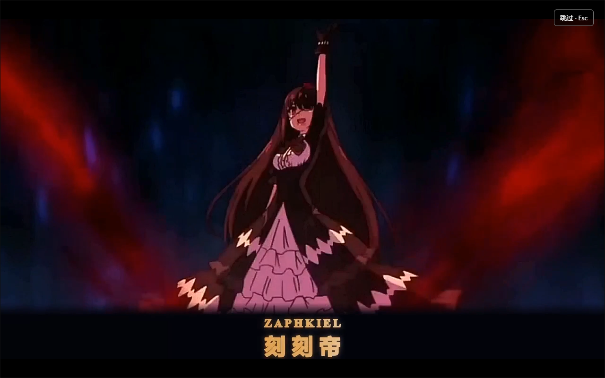

# zero-3 · 时崎狂三 Codex 窗口内启动动画

Windows 本地动画项目，当前版本 **1.5.0**。四段“刻刻帝”影片随机播放，每段8秒，避免连续重复。启动器连接官方 Codex 的本机调试端口，在唯一主窗口中尽早挂入黑幕，再读取影片、显示首帧，结束后撤除动画层。

**使用前请阅读：[使用须知与兼容性](docs/使用须知与兼容性.md)。** 不修改官方安装文件；官方原入口、客户端内重启、自动更新重启不自动接入。窗口内层不能保证官方窗口第一次绘制前绝无闪帧。



## 本次更新

- 默认在 Codex 窗口内播放；不等待聊天内容或整个页面加载完成，不再默认弹出独立播放器。
- 黑幕先于影片读取/传输，确认首帧后显像；结束、Esc、跳过或异常时清理自己的资源并恢复此前焦点。
- 四段4K60影片更新为清晰度修正版，只增强已有亮度细节，不生成新的人物纹理。
- 增加指定快捷方式修复、原件备份，并清除旧链接的官方分组标识。
- [更新记录](docs/CHANGELOG.md) · [视频核验摘要](docs/validation-v1.5.0.json) · [同帧对比](docs/clarity-comparison.png)。对比图从左到右是1.4.0基准、先前微增强版、本次清晰度版。

## 获取与运行

1. 使用 Windows 10/11 x64，安装微软商店的官方 Codex 和 **Node.js 22.3或更新版本**。
2. 克隆仓库或 Code → Download ZIP，完整解压到普通可写目录。下载体积较大，正式启动只读取 `films/`。
3. 保存工作并正常完全退出 Codex，包括后台实例，再双击 `CodexKurumiIntro.exe`。Esc 或右上角按钮可跳过。

`nodeExecutable` 留空时依次查找已安装的 Codex 任务运行时、Program Files 下的 Node、PATH。找不到时，在 `config.json` 填写本机 `node.exe` 绝对路径。公开配置不含个人路径。

接入现有桌面 `ChatGPT.lnk`，并保留原件：

```powershell
powershell.exe -NoProfile -ExecutionPolicy Bypass -File .\Install-DesktopShortcut.ps1
```

其他名称或位置使用 `-ShortcutPath`。开始菜单、任务栏或仍绕过动画的旧链接，可显式修复指定的现有文件：

```powershell
.\Repair-LaunchShortcuts.ps1 -ShortcutPaths @(
  "$env:APPDATA\Microsoft\Windows\Start Menu\Programs\ChatGPT.lnk"
)
```

只修改目标属于官方Codex或本包的链接；原件保存在本机 `shortcut-backups/`，重复修复不会覆盖。对相同文件运行同一命令并加 `-Restore` 即恢复。桌面安装脚本对应 `Restore-DesktopShortcut.ps1`，两套备份流程不要混用。

任务栏需要固定**修正后的快捷方式**；点击已运行应用的按钮通常只是切换窗口。固定原官方应用仍会绕过本项目。

## 画面与声音

- 前3秒流光线稿，前1秒像素故障和装饰窗口；前6秒曲线变速、运镜和召唤节点震动。
- 只沿原画已出现的大钟边缘扩散轮廓与粒子，残缺部分保持残缺，没有额外绘制的表盘。
- 金色流光双语字幕“ZAPHKIEL / 刻刻帝”；钟体显现后敲响一次 Zi-O 钟声，保留原音自然衰减，不加时针声、不循环或拉长。
- 6～8秒中心滴水、水波与逐渐模糊，7～8秒拉远退出。清晰度修正不撤销这段有意设置的模糊。

| 内容 | 规格 / 位置 |
| --- | --- |
| 当前启动影片 | `films/`，3840×2160、60fps、480帧、H.264 + AAC，各8秒 |
| 历史8K存档 | `masters/`，7680×4320、90fps、HEVC，保留1.4.0版本，未应用本次清晰度修正 |
| 效果参数 | `effect-parameters.json`，剪映意向数值与等效处理记录 |
| 影片校验 | `manifest.json`，影片规格、时长、SHA256 |
| 验证摘要 | `docs/validation-v1.5.0.json`，四片全帧与音频包核验 |

原始素材为540p/720p、30fps。4K/8K是输出尺寸，不能等同原生高分辨率细节；没有16K成片。此次在1.4.0成片上增强亮度，没有再次缩放、补帧、变速、重绘面部或添加虚构纹理。无损阶段的色度和保护区保持原样，启动MP4另有有损编码误差，不承诺绝对零误差。FFV1验证母版不打包进本仓库。

## 配置与诊断

`codexExecutable`、`wallpaperProject`、`nodeExecutable` 默认留空。客户端路径和 Node 可自动查找；可选外部 CodexChatWallpaper 需自行配置，本仓库不打包或替换该壁纸工程。

启动沿用 `127.0.0.1:9335` 与 `%LOCALAPPDATA%\CodexChatWallpaper\profile`。同机程序可能通过调试端口控制已登录客户端；撤掉动画不关闭连接，需完全退出该实例后从官方普通入口打开。详见使用须知。

`intro.log` 记录遮罩、首帧和结束，`native-startup.log` 记录入口，`bootstrap.log` 记录客户端与壁纸启动。八秒是**影片时长**；等待主文档、传输和解码会增加总耗时。

```powershell
.\CodexKurumiIntro.exe --preview  # 独立预览，不启动Codex
.\CodexKurumiIntro.exe --native   # 原独立播放器，后台启动Codex
node .\intro.mjs --check          # 只检查配置和影片
node .\preview-server.mjs         # 隔离浏览器预览，不连接Codex
```

窗口内播放失败不会自动再播放一份独立动画。

## 开发与验证

`NativeStartup.cs` 是入口与互斥控制，`intro.mjs` 是窗口内控制器，`overlay.mjs` 是临时动画层，`Verify-CodexListener.ps1` 独立校验监听进程。修改C#后运行 `Build-NativeStartup.ps1`。

Windows下运行 `npm test`；测试使用临时文件和模拟连接，不启动或控制真实Codex。制作算法另有 `python tools/test_clarity_v2_luma.py`；留档及依赖见 [tools/README.md](tools/README.md)。

本次验证了安全测试、隔离浏览器的播放/跳过/清理，以及四片全帧与音频包。**这些不等同新版官方客户端冷启动测试**；设备、驱动与客户端更新后的实际时序仍需本机确认。

## 来源与许可

窗口内外观层参考 [Baili for Codex](https://github.com/chenyi380/baili-codex)；早期遮罩、首帧判据与清理原则参考 [dsh-startup-screen](https://github.com/6shenhonghong9/dsh-startup-screen) 和 [dsh-wallpaper-engine](https://github.com/elysia395/dsh-wallpaper-engine)。没有引入DSH专用宿主接口或音画素材。代码保留MIT许可和署名，见 [LICENSE](LICENSE)、[UPSTREAM-LICENSE.txt](UPSTREAM-LICENSE.txt)。本项目为非官方社区作品。

动漫角色、片段、对白、音乐与Zi-O钟声属于各自权利人，代码许可不包含这些媒体。钟声来自 [Zi-o clock sound](https://www.myinstants.com/en/instant/zi-o-clock-sound-81953/)，记录见 `assets/source.json`。
