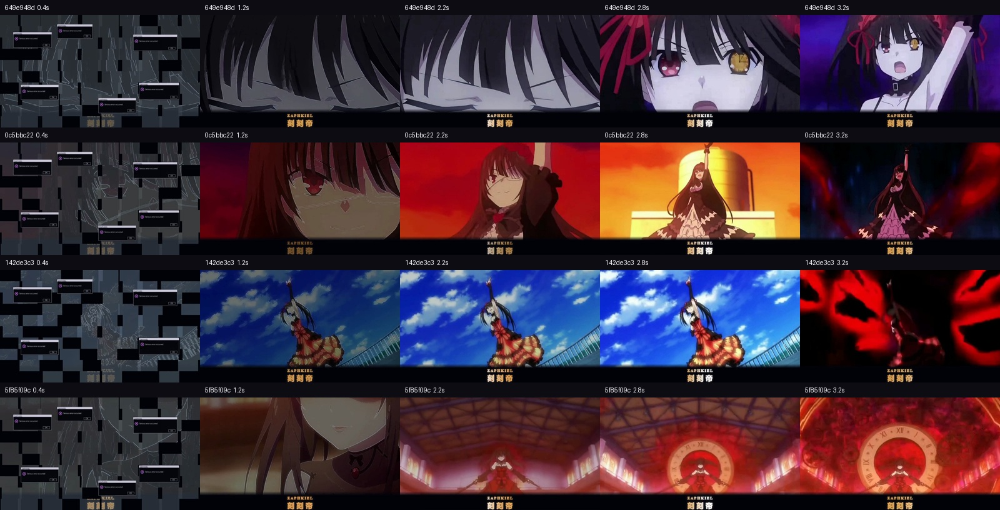

# zero-3 · 时崎狂三 Codex 启动动画

Windows 本地启动动画项目，当前版本 **1.4.0**。四段时崎狂三“刻刻帝”片段随机播放，每段8秒，避免连续重复。使用独立原生全屏播放器先遮住画面，再在背后启动官方Codex，结束后显示客户端。

**使用前请阅读：[使用须知与兼容性说明](docs/使用须知与兼容性.md)。** 文档包含电脑性能差异、重复进程、八秒以上冷启动、视频解码、多屏、排查与恢复方法。



## 当前效果

- 前3秒流光线稿显现，前1秒加入像素故障和装饰窗口叠层。
- 前6秒曲线变速、运镜切换和召唤节点震动。
- 只沿原画已出现的大钟边缘向外扩散描边与粒子；残缺轮廓保持残缺，没有另加表盘。
- 金色流光双语字幕“ZAPHKIEL / 刻刻帝”。
- 钟体显现到位后敲响一次Zi-O钟声，保留原音自然强弱和拖尾，不加时针声、不循环、不拉长。
- 最后2秒中心滴水、水波扩散及逐渐模糊，最后1秒变焦拉远。

## 获取与运行

通过Git克隆，或在本页选择 **Code → Download ZIP** 后完整解压。仓库包含播放器、源码、四段启动影片和四段8K存档，总体积约430MB；正式启动只读取 `films/`。

1. 使用Windows x64电脑，并安装官方Codex。将项目放在普通可写目录。
2. 直接双击 `CodexKurumiIntro.exe` 试用；右上角“跳过”或Esc可退出动画。
3. 如需接入现有桌面图标，在项目目录运行：

```powershell
powershell.exe -NoProfile -ExecutionPolicy Bypass -File .\Install-DesktopShortcut.ps1
```

默认修改桌面的 `ChatGPT.lnk` 并保留图标。首次安装会在项目目录保存原快捷方式；如图标名称或位置不同，可以显式指定：

```powershell
powershell.exe -NoProfile -ExecutionPolicy Bypass -File .\Install-DesktopShortcut.ps1 -ShortcutPath 'D:\Desktop\Codex.lnk'
```

恢复入口：

```powershell
powershell.exe -NoProfile -ExecutionPolicy Bypass -File .\Restore-DesktopShortcut.ps1
```

只预览动画而不启动Codex：

```powershell
.\CodexKurumiIntro.exe --preview
```

`preview.html` 可以选择查看各段影片。源码更新后运行 `Build-NativeStartup.ps1`，用系统现有.NET Framework编译器重建原生播放器。正常播放不需要Node、Python或FFmpeg。

## 配置与播放规格

| 内容 | 规格 / 位置 |
| --- | --- |
| 默认启动影片 | `films/`，3840×2160、60fps、H.264 + AAC，各8秒 |
| 高规格存档 | [masters/](masters/)，7680×4320、90fps、HEVC + AAC，各8秒 |
| 画面参数 | `effect-parameters.json`，保留剪映意向数值与等效处理参数 |
| 文件校验 | `manifest.json`，影片分辨率、帧数、时长和SHA256 |
| 声音来源 | `assets/source.json`，确认使用的单次钟声及各段落点 |
| 客户端和壁纸路径 | `config.json`，公开版本默认留空个人路径 |

客户端默认自动查找微软商店的官方安装。可选壁纸项目需另行配置 `wallpaperProject`，本仓库没有打包外部CodexChatWallpaper。默认后台启动沿用该集成的资料目录与本机调试端口，详情见须知。

原片为540p/720p，经光流插帧和缩放；输出规格不代表原生4K/8K细节。剪映专有滤镜按确认方案用调色、降噪、局部对比和锐化等效实现。8K90用于存档，优先以4K60保证启动兼容与流畅；没有16K成片。

**八秒是影片时长，不是Codex启动时限。** 原生播放器不等待聊天页面。如果客户端启动更慢，动画仍正常结束，客户端会继续启动。系统互斥锁防止同目录重复播放；多个副本、旧脚本或其他启动入口仍可能带来进程和焦点冲突，见兼容性说明。

## 开发与制作留档

`NativeStartup.cs` 为当前播放器，`Start-CodexForIntro.ps1` 为后台启动；`intro.mjs` 等CDP覆盖层保留为可选旧版诊断工具，不是正常启动路径。

测试需Windows、Node 22+和可用的.NET Framework/WPF环境；测试使用隔离的临时文件，不修改真实桌面入口，也不启动真实客户端：

```powershell
npm test
```

剪辑脚本与阶段依赖见 [tools/README.md](tools/README.md)。它们记录制作过程，缺少原始素材和中间文件时不能直接重新导出整套影片。

## 来源与许可

原CDP外观层参考 [白璃 · Baili for Codex](https://github.com/chenyi380/baili-codex)，代码保留上游MIT许可与署名，见 [LICENSE](LICENSE) 和 [UPSTREAM-LICENSE.txt](UPSTREAM-LICENSE.txt)。本项目不是OpenAI官方功能。

《约会大作战》角色、动画片段、对白、音乐与Zi-O钟声属于各自权利人，代码MIT许可不包含这些媒体。钟声来自 [Zi-o clock sound](https://www.myinstants.com/en/instant/zi-o-clock-sound-81953/)。仓库不包含私人聊天视频、原始快捷方式、个人路径配置或本机日志。
