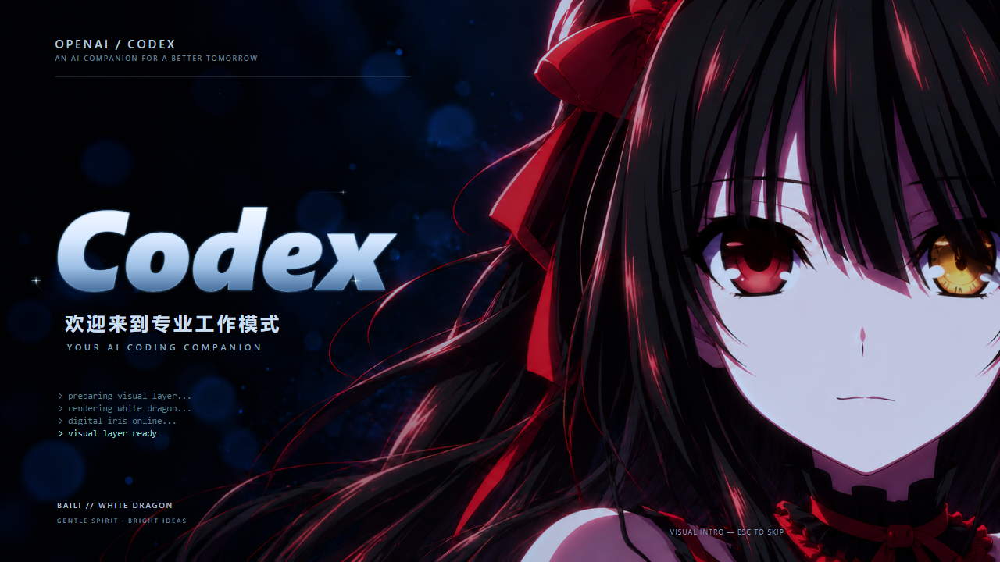

# 时崎狂三 · 自定义16秒启动动画

**独立项目 `codex-kurumi-custom-16s`，版本 `1.0.0`，2026-10-29。**

这是本次确认并安装到本机的单片16秒版本。仓库根目录仍保留原来的 **1.6.0四段随机启动项目**；两套影片、素材和源码分别存放，本目录不替换根目录的旧项目。

| 文件 | 用途 |
|---|---|
| [4K60正式影片](films/kurumi-custom-16s-4k60.mp4) | 16秒、3840×2160、60fps；与本机已安装影片逐字节相同 |
| [1080p120流畅预览](previews/kurumi-custom-16s-1080p120.mp4) | 16秒、1920×1080、120fps，保留真实中间动作帧 |
| [素材与动画源码](source/) | 已确认第四版人物底图、眼皮分层、原发丝动作与完整渲染器 |
| [启动器兼容修正](launcher-compat/) | 按实际片长播放及排除Spotlight辅助页的修正，独立于旧项目保存 |
| [文件指纹与参数](media-manifest.json) | 恢复时用来核对准确版本 |
| [验证记录](verification/) | 完整解码、运动连续性、局部合成及独立静帧审查 |

## 这版的画面

采用已确认的第四版正脸与嘴型。B版快闭眼、A版慢睁眼：闭合0.20秒、全闭停留1/60秒、睁开0.90秒；眨眼从10.70秒和13.86秒开始。
闭合保持原生13个采样位置，使用单调C1插值生成中间帧；下眼皮只在半睁附近平滑停止，保留已确认的眼形和时序。
原发丝动作、镜头、文字、转场和音乐沿用。120fps文件为逐帧重新计算，不是把60fps画面简单重复成120fps。

## 与根目录旧项目的区别

| 项目 | 根目录原版 | 本目录自定义版 |
|---|---|---|
| 影片结构 | 四段各8秒，随机选择 | 单片16秒 |
| 人物画面 | 原始动画片段及钟表效果 | 已确认第四版底图与局部眨眼 |
| 视频位置 | 根目录films/ | projects/kurumi-custom-16s/films/ |
| 版本标识 | 1.6.0 | custom16-1.0.0 |

不要把本目录的素材、配置或兼容修正无差别覆盖到根目录旧项目。

## 下次恢复这一版

告诉助手“从zero-3的projects/kurumi-custom-16s恢复自定义16秒启动动画”，并提供当时的实际启动器目录。路径不能唯一确定时应先确认，不猜测安装位置。
先核对4K60影片SHA256：`03b3b478e15f1d932156844367c8f63c6cc8aa6b0c8726f6e68ae3405b52955e`。
若当前启动器已支持单片16秒，备份原影片后只替换实际播放列表指向的影片内容即可；无需改壁纸、快捷方式或其它本机设置。
若使用旧版8秒播放器，需先检查launcher-compat/中的按实际片长播放修正；这些文件是备查源码，不应覆盖未知的新版本代码。当前配置中的端口、Node、Codex及壁纸路径应保留本机实际值，不从其它电脑复制。
本仓库没有保存本机安装路径、运行日志、桌面快捷方式或个人config.json。

## 预览与从源码导出

已有MP4无需安装依赖即可播放。开发预览需要Node.js 20以上：在本目录运行`node tools/serve.mjs`，打开终端显示的本机地址。页面链接到源码预览，提供4K60与1080p120导出按钮。
源码导出需要支持WebCodecs的Chromium浏览器；保留原音轨的封装另需FFmpeg在PATH中，或通过`FFMPEG`环境变量指定。导出结果保存到本项目exports/，不修改本机Codex。
测试：`node --test source/tests/*.test.mjs tests/*.test.mjs launcher-compat/tests/*.test.mjs`。

## 许可与验证范围

代码及第三方依赖许可见LICENSE、ASSET-NOTICE.md和source/vendor/。
成片完整解码、音轨负载和帧数检查通过；独立审查覆盖源码、数值与抽样静帧，没有声称人工完整播放或听审。
